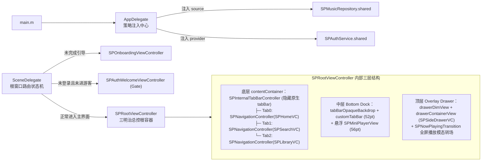

# 第 1 层：App 与根容器架构层 (`Spotify/App/`)

> [← 返回架构总控台](README.md) · **当前位置**：区块一（层级架构） > 第 1 层 App 与根容器层
> **按需跳转到重点实现逻辑**：[专题 ⑦：界面架构、三明治根容器与丝滑转场](07-界面架构与丝滑转场交互.md) · [专题 ①：协议供需与启动依赖注入](01-协议接口供需全景与Runtime实战.md)

---

## 1. 本层局部架构图

`Spotify/App/` 目录共包含 4 个核心类，承担 **启动策略注入**、**窗口根路由状态机**、**全局三明治视图容器** 以及 **无导航栏全屏手势恢复** 四项顶层职责：

---

## 2. 本层核心类与方法实现清单

### 2.1 `AppDelegate` — 依赖注入与全局缓存配置
- **源码文件**：[AppDelegate.h](file:///Users/dyyxs/项目/Spotify/Spotify/App/AppDelegate.h) / [AppDelegate.m](file:///Users/dyyxs/项目/Spotify/Spotify/App/AppDelegate.m#L17-L45)
- **核心职责**：在 `-application:didFinishLaunchingWithOptions:` 中完成协议实现类的装配（UI 控制器无需关心当前是网易云还是 Mock）。
- **关键方法与逻辑**：
  - [`-application:didFinishLaunchingWithOptions:`](file:///Users/dyyxs/项目/Spotify/Spotify/App/AppDelegate.m#L19-L37)：
    1. 读取 `NSUserDefaults` 的 `sp_music_source_type_v1`，向 `[SPMusicRepository shared].source` 注入 `SPNeteaseMusicSource`（默认）或 `SPMockMusicSource`。
    2. 读取 `sp_auth_provider_type_v1`，向 `[SPAuthService shared].provider` 注入 `SPLocalAuthProvider`（默认）或 `SPNeteaseAuthProvider`。
    3. 设置 `SDImageCache.sharedImageCache.config.maxMemoryCost = 80 * 1024 * 1024`（限制封面内存缓存上限为 80MB）。

### 2.2 `SceneDelegate` — 根控制器状态机与平滑切换
- **源码文件**：[SceneDelegate.h](file:///Users/dyyxs/项目/Spotify/Spotify/App/SceneDelegate.h) / [SceneDelegate.m](file:///Users/dyyxs/项目/Spotify/Spotify/App/SceneDelegate.m#L17-L109)
- **核心职责**：管理 `UIWindow` 及首屏门禁路由，提供带 `UIViewAnimationOptionTransitionCrossDissolve` 交叉溶解动画的根控制器切换接口。
- **关键方法与逻辑**：
  - [`-scene:willConnectToSession:options:`](file:///Users/dyyxs/项目/Spotify/Spotify/App/SceneDelegate.m#L45-L75)：按优先级判断：
    1. 若带 `-SPSelfTest` 启动参数 → 直接进 `SPRootViewController` 并延迟 1 秒启动自动化自检 [`SPSelfTestRunner`](file:///Users/dyyxs/项目/Spotify/Spotify/Core/Utils/SPSelfTestRunner.m)。
    2. 若 `![SceneDelegate hasCompletedOnboarding]` → 进入新手引导 [`SPOnboardingViewController`](file:///Users/dyyxs/项目/Spotify/Spotify/Modules/Onboarding/SPOnboardingViewController.m)。
    3. 若 `![SPAuthService shared].isLoggedIn && ![SceneDelegate hasEnteredGuestMode]` → 进入登录欢迎门禁 [`SPAuthWelcomeViewController`](file:///Users/dyyxs/项目/Spotify/Spotify/Modules/Auth/SPAuthWelcomeViewController.m)。
    4. 否则 → 进入主界面 [`SPRootViewController`](file:///Users/dyyxs/项目/Spotify/Spotify/App/SPRootViewController.m)。
  - [`-transitionToMainAppAnimated:` / `-transitionToAuthWelcomeAnimated:`](file:///Users/dyyxs/项目/Spotify/Spotify/App/SceneDelegate.m#L79-L107)：供引导结束、登录成功或设置页退出登录时调用，平滑替换 `window.rootViewController`。

### 2.3 `SPRootViewController` — 全局三明治总控容器
- **源码文件**：[SPRootViewController.h](file:///Users/dyyxs/项目/Spotify/Spotify/App/SPRootViewController.h) / [SPRootViewController.m](file:///Users/dyyxs/项目/Spotify/Spotify/App/SPRootViewController.m#L149-L629)
- **实现的协议**：`<SPPlayerObserver, UIGestureRecognizerDelegate>`
- **核心职责**：将 Tab 页面容器、自定义底栏、悬浮迷你播放条、左侧个人抽屉以及全屏播放页转场整合在单一根控制器下。
- **内部私有辅助类**：
  - [`SPInternalTabBarController`](file:///Users/dyyxs/项目/Spotify/Spotify/App/SPRootViewController.m#L25-L51)：继承自 `UITabBarController`，在 `viewDidLoad` 与 `viewDidLayoutSubviews` 中强制隐藏系统 `tabBar`，仅复用系统 Tab 的子控制器生命周期管理能力。
  - [`SPTabItemButton`](file:///Users/dyyxs/项目/Spotify/Spotify/App/SPRootViewController.m#L53-L121)：继承自 `SPScaleButton`（带按压弹性缩放），封装 SF Symbols 图标与标题的选中态切换。
- **关键方法清单**：
  | 方法名 | 行号定位 | 核心作用 | 关联深度专题 |
  | :--- | :--- | :--- | :--- |
  | `-setupTabs` & `-setupBottomDock` | [L192-L283](file:///Users/dyyxs/项目/Spotify/Spotify/App/SPRootViewController.m#L192-L283) | 挂载 3 个 Tab 导航控制器、52pt 自定义底栏与 56pt `SPMiniPlayerView` | [界面架构详解](07-界面架构与丝滑转场交互.md) |
  | `-updateTabDockMetrics` | [L305-L313](file:///Users/dyyxs/项目/Spotify/Spotify/App/SPRootViewController.m#L305-L313) | 根据 MiniPlayer 是否可见，动态修改子 VC 的 `additionalSafeAreaInsets.bottom` | [界面架构详解](07-界面架构与丝滑转场交互.md) |
  | `-updateMiniPlayerVisibilityAnimated:` | [L408-L437](file:///Users/dyyxs/项目/Spotify/Spotify/App/SPRootViewController.m#L408-L437) | 响应 `SPPlayerObserver -playerDidChangeTrack:`，带弹簧动画弹出/收起迷你播放条 | [协议供需详解](01-协议接口供需全景与Runtime实战.md) |
  | `-handleDrawerPan:` & `-applyDrawerProgress:` | [L469-L502](file:///Users/dyyxs/项目/Spotify/Spotify/App/SPRootViewController.m#L469-L502) | 底层 `contentContainer` 保持静止，仅平移顶层 `drawerContainerView`，实现零抖动抽屉 | [界面架构详解](07-界面架构与丝滑转场交互.md) |
  | `-handleDrawerAction:` | [L562-L591](file:///Users/dyyxs/项目/Spotify/Spotify/App/SPRootViewController.m#L562-L591) | 点击抽屉菜单时先在底层导航栈 `pushViewController:animated:NO`，再滑出抽屉 | [界面架构详解](07-界面架构与丝滑转场交互.md) |
  | `-presentNowPlaying` | [L602-L615](file:///Users/dyyxs/项目/Spotify/Spotify/App/SPRootViewController.m#L602-L615) | 使用 `SPNowPlayingTransition` 自定义转场弹出全屏播放页 | [界面架构详解](07-界面架构与丝滑转场交互.md) |

### 2.4 `SPNavigationController` — 无导航栏全屏容器与侧滑手势恢复
- **源码文件**：[SPNavigationController.h](file:///Users/dyyxs/项目/Spotify/Spotify/App/SPNavigationController.h) / [SPNavigationController.m](file:///Users/dyyxs/项目/Spotify/Spotify/App/SPNavigationController.m#L11-L30)
- **核心职责**：Spotify 的每个页面都有定制的渐变顶栏（如首页胶囊顶栏、详情页渐变透明顶栏），因此必须全局隐藏系统 `UINavigationBar`。但隐藏系统导航栏会导致系统 `interactivePopGestureRecognizer` 失效。
- **关键方法**：
  - [`-viewDidLoad`](file:///Users/dyyxs/项目/Spotify/Spotify/App/SPNavigationController.m#L13-L19)：设置 `self.navigationBarHidden = YES`，并将 `self.interactivePopGestureRecognizer.delegate = self`。
  - [`-gestureRecognizerShouldBegin:`](file:///Users/dyyxs/项目/Spotify/Spotify/App/SPNavigationController.m#L21-L26)：当 `self.viewControllers.count > 1` 时允许侧滑返回手势触发，在根控制器时禁止触发（避免卡死导航栈）。

---

> **下一层导航**：[前往第 2 层：Data 数据与网络架构层 →](02-Data数据与网络架构层.md)
