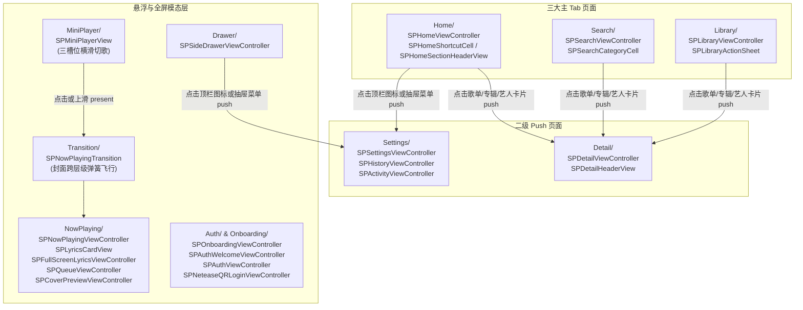

# 第 5 层：Modules 业务界面模块层 (`Spotify/Modules/`)

> [← 返回架构总控台](README.md) · [← 上一层：Core 基础与 Models 领域层](04-Core基础组件与Models领域模型层.md) · **当前位置**：区块一（层级架构） > 第 5 层 Modules 业务界面层
> **按需跳转到重点实现逻辑**：[专题 ⑥：首页无限刷新与渐进分页](06-首页无限刷新与渐进分页.md) · [专题 ⑦：界面架构与丝滑转场交互](07-界面架构与丝滑转场交互.md)

---

## 1. 本层局部架构图

`Spotify/Modules/` 包含 10 个独立业务子目录，所有模块之间**不直接持有对方状态**，而是统一通过 `SPMusicRepository`、`SPPlayerService`、`SPLibraryStore`、`SPAuthService` 进行数据读写与事件联动：

---

## 2. 各业务模块核心类与方法速查

### 2.1 `Modules/Home/` — 首页模块
- **核心文件**：[SPHomeViewController.m](file:///Users/dyyxs/项目/Spotify/Spotify/Modules/Home/SPHomeViewController.m#L103-L652)、[SPHomeShortcutCell.m](file:///Users/dyyxs/项目/Spotify/Spotify/Modules/Home/Views/SPHomeShortcutCell.m)、[SPHomeSectionHeaderView.m](file:///Users/dyyxs/项目/Spotify/Spotify/Modules/Home/Views/SPHomeSectionHeaderView.m)
- **架构亮点**：
  - 使用 `UICollectionViewCompositionalLayout` 动态构建 3 种 Section：顶部双列 8 宫格 (`SPHomeSectionStyleShortcut`)、横向连续滚动方形卡片 (`SPHomeSectionStyleCard`)、横向连续滚动圆形艺人 (`SPHomeSectionStyleArtist`) + 全局底部加载补充视图 (`SPHomeLoadMoreFooterView`)。
  - 首屏加载完成后通过 [`-warmupPlayerIfNeededWithSections:`](file:///Users/dyyxs/项目/Spotify/Spotify/Modules/Home/SPHomeViewController.m#L499-L530) 自动调用 `[[SPPlayerService shared] prepareTracks:startIndex:0 contextTitle:]`，确保用户一打开 App 底部就有迷你播放条待命。
  - 首次渲染时通过 [`-playInitialEntranceIfNeeded`](file:///Users/dyyxs/项目/Spotify/Spotify/Modules/Home/SPHomeViewController.m#L435-L463) 将可见 Cell 按从上到下、从左到右排序，执行 `i * 0.04s` 错峰交错上浮入场动画 (Stagger Entrance)。

### 2.2 `Modules/Search/` — 搜索模块
- **核心文件**：[SPSearchViewController.m](file:///Users/dyyxs/项目/Spotify/Spotify/Modules/Search/SPSearchViewController.m#L48-L530)、[SPSearchCategoryCell.m](file:///Users/dyyxs/项目/Spotify/Spotify/Modules/Search/Views/SPSearchCategoryCell.m)
- **架构亮点**：
  - 双视图无缝切换：搜索框为空时展示双列彩色旋转贴图分类网格 (`categoryCollectionView`，卡片右下角封面旋转 $25^\circ$ 复刻 Spotify 经典分类卡片)；输入文字时隐藏网格并展示分组结果列表 (`resultTableView`)。
  - **0.25s 输入防抖 (Debounce)**：在 [`-textDidChange:`](file:///Users/dyyxs/项目/Spotify/Spotify/Modules/Search/SPSearchViewController.m) 中使用 `dispatch_block_create` + `dispatch_block_cancel(self.pendingSearchBlock)` + `dispatch_after(0.25s)`，避免用户打字过程中每个字符都触发网络请求；且对搜索结果按「歌曲 / 艺人 / 专辑 / 歌单」自动拆分为 4 个 Section，点击歌曲直接把当前搜索到的全部歌曲作为播放队列起播。

### 2.3 `Modules/Library/` — 音乐库与歌单收藏面板
- **核心文件**：[SPLibraryViewController.m](file:///Users/dyyxs/项目/Spotify/Spotify/Modules/Library/SPLibraryViewController.m#L113-L500)、[SPLibraryActionSheet.m](file:///Users/dyyxs/项目/Spotify/Spotify/Modules/Library/SPLibraryActionSheet.m)
- **架构亮点**：
  - 融合本地持久化数据 (`SPLibraryStore` 的「已点赞的歌曲」、用户自建歌单、已关注艺人) 与远端数据源 (`fetchLibraryItemsWithCompletion:`)，分为 Section 0「我的个人音乐（本地持久化 + 网易云同步）」与 Section 1「发现更多精选歌单与艺人」。
  - 支持顶部过滤胶囊（全部 / 歌单 / 专辑 / 艺人）与「列表视图 / 网格视图 (`isGridMode`)」一键带动画切换布局。
  - [`SPLibraryActionSheet`](file:///Users/dyyxs/项目/Spotify/Spotify/Modules/Library/SPLibraryActionSheet.m)：在任意歌曲旁点击 `···` 弹出的歌单选择器，支持把歌曲一键加入「已点赞的歌曲」、现有自建歌单，或当场弹窗新建歌单并自动收藏。

### 2.4 `Modules/Detail/` — 歌单/专辑/艺人多态详情页
- **核心文件**：[SPDetailViewController.m](file:///Users/dyyxs/项目/Spotify/Spotify/Modules/Detail/SPDetailViewController.m#L37-L467)、[SPDetailHeaderView.m](file:///Users/dyyxs/项目/Spotify/Spotify/Modules/Detail/Views/SPDetailHeaderView.m)
- **架构亮点**：
  - 接收 `id<SPMediaItem>` 初始化，自动适配歌单、播客、专辑、艺人 4 种形态（例如专辑详情隐藏每行小封面只显示曲目名，艺人详情在表头显示「关注 / 已关注」胶囊按钮，自建歌单在更多菜单显示「删除此歌单」，推荐歌单显示「另存为我的歌单」）。
  - 滚动联动 ([`-scrollViewDidScroll:`](file:///Users/dyyxs/项目/Spotify/Spotify/Modules/Detail/SPDetailViewController.m#L425-L438))：向下拉时放大表头封面 (`1.0 + stretch`)，向上滚时背景渐变微视差上移 (`offsetY * 0.35`) 并在滚过表头标题后渐显顶部导航栏标题。

### 2.5 `Modules/MiniPlayer/` & `Modules/NowPlaying/` & `Modules/Transition/` — 播放体验三件套
- **`SPMiniPlayerView`** ([SPMiniPlayerView.m](file:///Users/dyyxs/项目/Spotify/Spotify/Modules/MiniPlayer/SPMiniPlayerView.m#L89-L469))：悬浮迷你播放条，支持三槽位横滑切歌、背景色实时插值、底部 2pt 双轨进度条（白线播放进度 + 半透明白线缓冲进度）、点击或上滑呼出全屏播放页。
- **`SPNowPlayingViewController`** ([SPNowPlayingViewController.m](file:///Users/dyyxs/项目/Spotify/Spotify/Modules/NowPlaying/SPNowPlayingViewController.m#L195-L970))：
  - 主舞台 (`playerStageView`) + 下滑双语歌词卡片 (`SPLyricsCardView`) 垂直滚动组合。
  - 支持长按大封面呼出高清封面预览与保存相册页 ([`SPCoverPreviewViewController`](file:///Users/dyyxs/项目/Spotify/Spotify/Modules/NowPlaying/SPCoverPreviewViewController.m))、点击歌词卡右上角展开全屏歌词页 ([`SPFullScreenLyricsViewController`](file:///Users/dyyxs/项目/Spotify/Spotify/Modules/NowPlaying/SPFullScreenLyricsViewController.m))、点击右下角队列按钮弹出播放队列与待播列表页 ([`SPQueueViewController`](file:///Users/dyyxs/项目/Spotify/Spotify/Modules/NowPlaying/SPQueueViewController.m))。
- **`SPNowPlayingTransition`** ([SPNowPlayingTransition.m](file:///Users/dyyxs/项目/Spotify/Spotify/Modules/Transition/SPNowPlayingTransition.m#L15-L163))：封面跨层级飞行转场动画器。

### 2.6 `Modules/Drawer/` & `Modules/Settings/` & `Modules/Auth/`
- **`SPSideDrawerViewController`** ([SPSideDrawerViewController.m](file:///Users/dyyxs/项目/Spotify/Spotify/Modules/Drawer/SPSideDrawerViewController.m))：左侧个人抽屉，展示当前用户昵称、账号、VIP 徽章及「新动态 (`SPActivityViewController`)」「收听历史 (`SPHistoryViewController`)」「设置与隐私 (`SPSettingsViewController`)」入口。
- **`SPSettingsViewController`** ([SPSettingsViewController.m](file:///Users/dyyxs/项目/Spotify/Spotify/Modules/Settings/SPSettingsViewController.m#L337-L775))：自定义静默开关 `SPToggleSwitch`，提供深浅色主题切换、触感反馈开关、上下首预加载开关、**L1/L2/L3 三级缓存实时统计与一键清空**、**网易云 API / 本地 Mock 数据源热切换**、**自定义 API Base URL** 以及 **本地认证 / 网易云认证通道热切换**。

---

> **层级架构浏览完毕！接下来进入区块二（重点实现路径详解）**：
> [前往专题 ①：7 大协议接口供需全景与 Runtime 实战 →](01-协议接口供需全景与Runtime实战.md)
