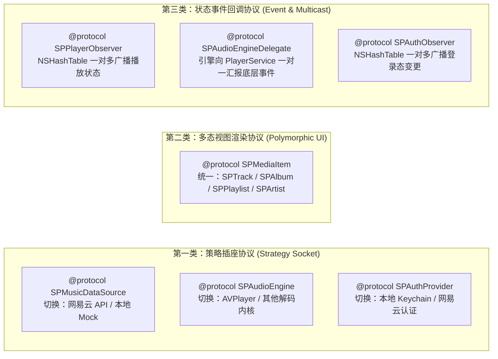

# 专题 ①：7 大协议接口供需全景与 OC Runtime 实战

> [← 返回架构总控台](README.md) · **当前位置**：区块二（重点实现路径详解） > 专题 ① 协议接口供需与 Runtime 实战
> **关联架构层**：[第 2 层 Data](02-Data数据与网络架构层.md) · [第 3 层 Player](03-Player播放器内核架构层.md) · [第 4 层 Core & Models](04-Core基础组件与Models领域模型层.md)

---

## 1. 你的核心困惑拆解：为什么要有这 7 个协议？谁提供、谁实现、给谁用？

在大型 Objective-C 项目中，如果类与类之间全部直接 `#import` 具体实现类（比如 `SPHomeViewController` 直接掉 `SPNeteaseMusicSource`，或者 `SPPlayerService` 直接操作 `AVPlayer`），代码会变成一团无法拆解的蜘蛛网。

本项目用 **7 个自定义 `@protocol`** 构建了三类解耦机制：



---

## 2. 路径环节一：`SPMusicDataSource`（门面 + 装饰器 + 策略模式三合一）

- **协议定义**：[SPMusicDataSource.h:L29-L72](file:///Users/dyyxs/项目/Spotify/Spotify/Data/SPMusicDataSource.h#L29-L72)
- **谁实现了它（3 个类）**：
  1. **[`SPNeteaseMusicSource`](file:///Users/dyyxs/项目/Spotify/Spotify/Data/Netease/SPNeteaseMusicSource.m#L15-L1042)**：通过 `SPHTTPClient` 请求真实网易云 API，并用 `SPNeteaseParser` 把 JSON 字典转成领域模型。
  2. **[`SPMockMusicSource`](file:///Users/dyyxs/项目/Spotify/Spotify/Data/Mock/SPMockMusicSource.m#L21-L363)**：读取本地 `mock_data.json` 并模拟网络延迟。
  3. **[`SPMusicRepository`](file:///Users/dyyxs/项目/Spotify/Spotify/Data/Repository/SPMusicRepository.m#L29-L316)**：**最关键的设计点**——`SPMusicRepository` 既是持有 `id<SPMusicDataSource> source` 的门面，它自己也遵循 `<SPMusicDataSource>` 协议！
- **给谁调用、怎么用**：
  - **启动装配**：在 [AppDelegate.m:L20-L25](file:///Users/dyyxs/项目/Spotify/Spotify/App/AppDelegate.m#L20-L25)（或设置页 [SPSettingsViewController.m:L635-L652](file:///Users/dyyxs/项目/Spotify/Spotify/Modules/Settings/SPSettingsViewController.m#L635-L652)）中给插座插上具体数据源：
    ```objc
    [SPMusicRepository shared].source = [SPNeteaseMusicSource new]; // 或 [SPMockMusicSource new]
    ```
  - **业务层调用**：所有 ViewController 和 `SPAudioCacheManager` **永远不直接调 `SPNeteaseMusicSource`**，而是调 `[[SPMusicRepository shared] fetch...]`。
  - **Repository 内部做了什么包装？**（以 [SPMusicRepository.m:L206-L226](file:///Users/dyyxs/项目/Spotify/Spotify/Data/Repository/SPMusicRepository.m#L206-L226) `-fetchPlaylistWithId:completion:` 为例）：
    ```objc
    - (void)fetchPlaylistWithId:(NSString *)playlistId completion:(void (^)(SPPlaylist *, NSError *))completion {
        // ① 先查本地自建歌单仓库 SPLibraryStore
        SPPlaylist *local = [[SPLibraryStore shared] localPlaylistWithId:playlistId];
        if (local) { SP_MAIN_WORK(^{ if (completion) completion(local, nil); }); return; }

        // ② 再查 L3 内存 LRU 缓存 playlistCache
        SPPlaylist *cached = [self.playlistCache objectForKey:playlistId];
        if (cached && cached.tracks.count > 0) {
            SP_MAIN_WORK(^{ if (completion) completion(cached, nil); });
            return;
        }

        // ③ 缓存未命中，才转发给底层真正的 self.source（网易云或 Mock）
        id<SPMusicDataSource> currentSource = self.source;
        __weak typeof(self) weakSelf = self;
        [currentSource fetchPlaylistWithId:playlistId completion:^(SPPlaylist *playlist, NSError *error) {
            SP_MAIN_WORK(^{ // ④ 强制切回主线程，并校验数据源未在中途被切换
                if (weakSelf.source != currentSource) return;
                if (!error && playlist) [weakSelf.playlistCache setObject:playlist forKey:playlistId];
                if (completion) completion(playlist, error);
            });
        }];
    }
    ```

---

## 3. 路径环节二：`SPMediaItem`（消除 UI 层的类型判断分支）

- **协议定义**：[SPMediaItem.h:L20-L31](file:///Users/dyyxs/项目/Spotify/Spotify/Models/SPMediaItem.h#L20-L31)
- **谁实现了它**：`SPTrack`、`SPAlbum`、`SPPlaylist`、`SPArtist` 四个模型类。
- **给谁调用、怎么用**：
  - 首页的 `SPHomeSection.items`、搜索结果的 `SPSearchResultSection.items`、音乐库的 `personalItems / recommendedItems`，数组元素类型全部声明为 `NSArray<id<SPMediaItem>> *`。
  - 通用卡片 [`SPMediaCardCell -configureWithItem:`](file:///Users/dyyxs/项目/Spotify/Spotify/Core/Components/SPMediaCells.m#L147-L157)、通用列表行 [`SPMediaRowView -configureWithItem:`](file:///Users/dyyxs/项目/Spotify/Spotify/Core/Components/SPMediaRowView.m#L95-L101)、通用封面加载 [`UIImageView -sp_setCoverWithItem:`](file:///Users/dyyxs/项目/Spotify/Spotify/Core/Extensions/UIImageView+SPCover.m#L92-L133)、通用详情页 [`SPDetailViewController -initWithMediaItem:`](file:///Users/dyyxs/项目/Spotify/Spotify/Modules/Detail/SPDetailViewController.m#L39-L74) 全部只接收 `id<SPMediaItem>`。
  - **效果**：新增一种媒体形态（如播客电台）时，只需让它遵循 `SPMediaItem`（本项目将播客映射为 `identifier` 带 `dj:` 前缀的 `SPPlaylist`），全 App 的卡片、列表行、详情页无需改一行 UI 代码即可直接展示！

---

## 4. 路径环节三：`SPPlayerObserver` 与 Runtime 多播动态派发

- **协议定义**：[SPPlayerService.h:L32-L39](file:///Users/dyyxs/项目/Spotify/Spotify/Player/SPPlayerService.h#L32-L39)
- **工程痛点**：
  - 普通的 `weak id<Delegate> delegate` 只能一对一通知；
  - 系统的 `NSNotificationCenter` 虽然能一对多，但参数都塞在无类型的 `userInfo` 字典里，缺乏编译期协议方法签名检查。
- **本项目的解决方案（`NSHashTable` + Runtime 选择器派发）**：
  - 在 [SPPlayerService.m:L18, L46, L68-L80](file:///Users/dyyxs/项目/Spotify/Spotify/Player/SPPlayerService.m#L68-L80) 中：
    ```objc
    // 1. 使用 weakObjectsHashTable 弱引用持有所有观察者，观察者销毁时自动由 Runtime 置 nil 移除
    _observers = [NSHashTable weakObjectsHashTable];

    - (void)addObserver:(id<SPPlayerObserver>)observer { [self.observers addObject:observer]; }
    - (void)removeObserver:(id<SPPlayerObserver>)observer { [self.observers removeObject:observer]; }

    // 2. 通过 SEL 动态向所有实现了该可选方法的观察者广播
    - (void)notify:(SEL)selector {
        for (id<SPPlayerObserver> observer in self.observers.allObjects) {
            if ([observer respondsToSelector:selector]) {
                [observer performSelector:selector withObject:self];
            }
        }
    }
    ```
  - **注意 `self.observers.allObjects` 的细节**：遍历前先调用 `.allObjects` 生成一份不可变快照数组，防止某个观察者在回调方法内部触发创建/销毁其他观察者导致 `NSHashTable` 遍历期间被修改而崩溃 (`Collection was mutated while being enumerated`)。
- **全项目 8 个 `SPPlayerObserver` 订阅者职责对照表**：
  | 订阅者类 | 源码位置 | 实现了哪些回调方法 | 具体执行的 UI 动作 |
  | :--- | :--- | :--- | :--- |
  | `SPRootViewController` | [SPRootViewController.m:L435](file:///Users/dyyxs/项目/Spotify/Spotify/App/SPRootViewController.m#L435-L437) | `playerDidChangeTrack:` | 首次有歌曲时带弹簧动画升起 `SPMiniPlayerView`，并重算子 Tab 的 `additionalSafeAreaInsets.bottom` |
  | `SPMiniPlayerView` | [SPMiniPlayerView.m:L441-L460](file:///Users/dyyxs/项目/Spotify/Spotify/Modules/MiniPlayer/SPMiniPlayerView.m#L441-L460) | 全部 5 个方法 | 刷新中/左/右三槽位封面与背景色、切换播放/暂停/菊花图标、更新底部 2pt 双轨进度条 |
  | `SPNowPlayingViewController` | [SPNowPlayingViewController.m:L953-L968](file:///Users/dyyxs/项目/Spotify/Spotify/Modules/NowPlaying/SPNowPlayingViewController.m#L953-L968) | 全部 5 个方法 | 刷新大封面三槽位与背景渐变、拉取新歌双语 LRC 歌词、驱动歌词滚动高亮、缩放封面尺寸 |
  | `SPDetailViewController` | [SPDetailViewController.m:L453-L465](file:///Users/dyyxs/项目/Spotify/Spotify/Modules/Detail/SPDetailViewController.m#L453-L465) | `ChangeTrack` / `ChangeState` / `ChangeMode` | 遍历当前可见行 (`indexPathsForVisibleRows`)，将正在播放的那一行标题变绿并启动 `SPNowPlayingIndicatorView` 音律跳动，同步表头大绿播放按钮图标 |
  | `SPHomeViewController` | [SPHomeViewController.m:L485-L487](file:///Users/dyyxs/项目/Spotify/Spotify/Modules/Home/SPHomeViewController.m#L485-L487) | `playerDidChangeTrack:` | 提取当前播放歌曲封面的主色调，平滑渐变更新首页顶部 280pt 氛围背景光 (`ambientGradient`) |
  | `SPSearchViewController` | [SPSearchViewController.m:L509-L515](file:///Users/dyyxs/项目/Spotify/Spotify/Modules/Search/SPSearchViewController.m#L509-L515) | `ChangeTrack` / `ChangeState` | 更新搜索结果列表中正在播放歌曲行的高亮与音律动画 |
  | `SPHistoryViewController` | [SPHistoryViewController.m:L197-L203](file:///Users/dyyxs/项目/Spotify/Spotify/Modules/Settings/SPHistoryViewController.m#L197-L203) | `ChangeTrack` / `ChangeState` | 更新收听历史列表中正在播放歌曲行的高亮与音律动画 |
  | `SPQueueViewController` | [SPQueueViewController.m:L124-L130](file:///Users/dyyxs/项目/Spotify/Spotify/Modules/NowPlaying/SPQueueViewController.m#L124-L130) | `ChangeTrack` / `ChangeQueue` / `ChangeMode` / `ChangeState` | 实时刷新「当前播放」与「接下来播放 (`upNextTracks`)」队列列表 |

---

## 5. 路径环节四：OC Runtime 关联对象实战（`UIImageView+SPCover` 防复用闪烁）

- **源码位置**：[UIImageView+SPCover.m:L9-L90](file:///Users/dyyxs/项目/Spotify/Spotify/Core/Extensions/UIImageView+SPCover.m#L9-L90)
- **问题场景**：
  当列表页因为播放状态改变调用局部刷新，或 MiniPlayer/NowPlaying 槽位重新配置时，如果每次调 `-sp_setImageWithURLString:` 都先把 `self.image = nil` 并重置背景占位色，即使图片已经在 SDWebImage 内存缓存里，也会产生一帧置空重设的闪烁，甚至重复触发主色调提取回调。
- **Runtime 关联对象实现**：
  ```objc
  #import <objc/runtime.h>

  static const void *SPCoverCurrentURLKey = &SPCoverCurrentURLKey;

  - (nullable NSString *)sp_currentURLString {
      return objc_getAssociatedObject(self, SPCoverCurrentURLKey);
  }

  - (void)sp_setCurrentURLString:(nullable NSString *)urlString {
      objc_setAssociatedObject(self, SPCoverCurrentURLKey, urlString, OBJC_ASSOCIATION_COPY_NONATOMIC);
  }
  ```
- **防闪烁核心短路逻辑** ([L45-L50](file:///Users/dyyxs/项目/Spotify/Spotify/Core/Extensions/UIImageView+SPCover.m#L45-L50))：
  ```objc
  // 若当前 UIImageView 已经绑定的 URL 与新传入的 urlString 完全一致，且 image 已在位，直接短路返回！
  if (urlString.length > 0 && [[self sp_currentURLString] isEqualToString:urlString] && self.image != nil) {
      if (completion) completion(self.image);
      return;
  }
  [self sp_setCurrentURLString:urlString];
  ```
- **配合 SDWebImage 的两项高阶优化** ([L62-L89](file:///Users/dyyxs/项目/Spotify/Spotify/Core/Extensions/UIImageView+SPCover.m#L62-L89))：
  1. **解码期硬件缩略图降采样**：根据当前 `self.bounds` 计算像素边长 `side = MIN(width * scale, 600)`，传入 `SDWebImageContextImageThumbnailPixelSize`，避免把大图全尺寸解码进内存。
  2. **按缓存命中类型区分过渡动画**：传入 `SDWebImageAvoidAutoSetImage`，在回调中判断：只有 `cacheType == SDImageCacheTypeNone`（真正走网络下载）才播放 `0.18s` 的 `UIViewAnimationOptionTransitionCrossDissolve` 淡入动画；如果是命中内存或磁盘缓存，直接 `strongSelf.image = image;` 0ms 瞬时赋值，彻底杜绝列表滚动时的淡入闪烁感！

---

> **下一专题导航**：[前往专题 ②：网络申请、匿名 Cookie 防惊群与多路并发降级 →](02-网络申请与多源并发聚合.md)
