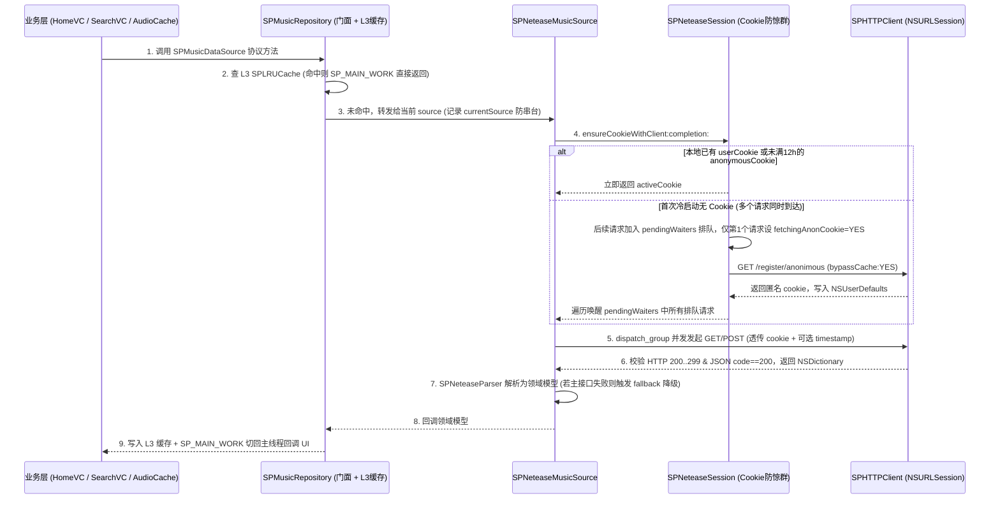

# 专题 ②：网络申请、匿名 Cookie 防惊群与多路并发降级

> [← 返回架构总控台](README.md) · [← 上一专题：协议接口供需与 Runtime 实战](01-协议接口供需全景与Runtime实战.md) · **当前位置**：区块二（重点实现路径详解） > 专题 ② 网络申请与并发聚合
> **关联架构层**：[第 2 层 Data 数据层](02-Data数据与网络架构层.md) · [第 4 层 Core 基础层](04-Core基础组件与Models领域模型层.md)

---

## 1. 调用路径总览图

当一个网络请求从业务层发起（例如首页加载、搜索或请求歌曲播放地址）时，依次穿过以下 4 个核心环节：



---

## 2. 路径环节一：`SPHTTPClient` — 针对网易云 API 定制的轻量网络引擎

- **源码位置**：[SPHTTPClient.h](file:///Users/dyyxs/项目/Spotify/Spotify/Core/Network/SPHTTPClient.h) / [SPHTTPClient.m:L15-L145](file:///Users/dyyxs/项目/Spotify/Spotify/Core/Network/SPHTTPClient.m#L15-L145)
- **为什么不用默认 `NSURLSession.sharedSession`？**
  1. **手动接管 Cookie**：在 [`-initWithBaseURL:`](file:///Users/dyyxs/项目/Spotify/Spotify/Core/Network/SPHTTPClient.m#L17-L29) 中专门设置 `config.HTTPShouldSetCookies = NO` 和 `config.requestCachePolicy = NSURLRequestReloadIgnoringLocalCacheData`。因为 NeteaseCloudMusicApi 服务端要求把 `cookie` 作为显式 Query 参数（GET）或 JSON Body 字段（POST）透传，关闭系统自动 Cookie 能防止不同账号/匿名态在系统 `NSHTTPCookieStorage` 中互相污染。
  2. **`bypassCache` 毫秒时间戳防服务端缓存** ([L57-L60](file:///Users/dyyxs/项目/Spotify/Spotify/Core/Network/SPHTTPClient.m#L57-L60))：
     NeteaseCloudMusicApi 服务端默认对相同 URL 做 2 分钟内存缓存。在请求播放 URL (`/song/url/v1`)、扫码轮询 (`/login/qr/check`)、用户歌单 (`/user/playlist`) 等需要实时数据的场景下，传入 `bypassCache:YES`，客户端会自动注入 `timestamp=<当前毫秒数>` 穿透服务端缓存：
     ```objc
     if (cookie.length > 0) {
         [items addObject:[NSURLQueryItem queryItemWithName:@"cookie" value:cookie]];
     }
     if (bypassCache) {
         long long ts = (long long)([[NSDate date] timeIntervalSince1970] * 1000.0);
         [items addObject:[NSURLQueryItem queryItemWithName:@"timestamp" value:[NSString stringWithFormat:@"%lld", ts]]];
     }
     ```
  3. **HTTP 状态码与业务 `code == 200` 双重校验 + `payload` 保留** ([L123-L138](file:///Users/dyyxs/项目/Spotify/Spotify/Core/Network/SPHTTPClient.m#L123-L138))：
     很多后端在业务报错时 HTTP 状态码依然是 200，而是在 JSON 里返回 `{"code": 400, "message": "..."}`；更有甚者，网易云二维码扫码检测接口 `/login/qr/check` 用 `code = 801`（等待扫码）、`802`（待确认）、`803`（扫码成功并附带 `cookie`）来表示正常状态流转！
     因此 `-executeRequest:completion:` 在 `apiCode != 200` 时虽然返回 `NSError`，但将原始 JSON 字典完整塞进了 `error.userInfo[@"payload"]`：
     ```objc
     NSError *apiErr = [NSError errorWithDomain:SPHTTPErrorDomain
                                           code:apiCode
                                       userInfo:@{NSLocalizedDescriptionKey: msg, @"payload": dict}];
     ```
     这样普通业务接口可以直接拿 `error.localizedDescription` 弹 Toast，而扫码接口 ([SPNeteaseAuthProvider.m:L117](file:///Users/dyyxs/项目/Spotify/Spotify/Core/Auth/SPNeteaseAuthProvider.m#L117)) 则能从 `error.userInfo[@"payload"]` 中平滑取出 `801/802/803` 状态码与 `cookie`！

---

## 3. 路径环节二：`SPNeteaseSession` — 匿名 Cookie 并发防惊群 (`pendingWaiters`)

- **源码位置**：[SPNeteaseSession.m:L101-L149](file:///Users/dyyxs/项目/Spotify/Spotify/Data/Netease/SPNeteaseSession.m#L101-L149)
- **工程痛点（并发惊群 Thundering Herd）**：
  网易云 API 即使在未登录状态下，也必须携带一个由 `/register/anonimous` 签发的匿名游客 Cookie，否则诸如 `/song/url/v1` 等接口会被风控拦截。
  但 App 首次冷启动时，首页请求、播放器预热请求等会**在同一毫秒并发触发**。如果不加锁合并，会同时发出多个 `/register/anonimous` 请求，不仅浪费连接，后返回的匿名 Cookie 还会覆盖先返回的 Cookie。
- **核心实现逻辑（双重检查锁 + 等待队列唤醒）**：
  ```objc
  - (void)ensureCookieWithClient:(SPHTTPClient *)client completion:(void (^)(NSString * _Nullable))completion {
      // 1. 快路径：已有 Keychain 用户 Cookie 或未满 12 小时的匿名 Cookie，立即返回
      NSString *existing = [self activeCookie];
      if (existing.length > 0) {
          if (completion) completion(existing);
          return;
      }

      // 2. 慢路径：加锁进入临界区，将回调入队 pendingWaiters
      BOOL shouldStart = NO;
      @synchronized (self) {
          NSString *doubleCheck = (self.userCookie.length > 0) ? self.userCookie : self.anonymousCookie;
          if (doubleCheck.length > 0) {
              if (completion) completion(doubleCheck);
              return;
          }
          if (completion) [self.pendingWaiters addObject:[completion copy]];
          if (!self.fetchingAnonCookie) {
              self.fetchingAnonCookie = YES;
              shouldStart = YES; // 只有第一个到达的线程负责真正发网络请求
          }
      }
      if (!shouldStart) return; // 其余并发调用入队后直接返回等待唤醒

      // 3. 发起唯一一次 /register/anonimous 请求，返回后批量唤醒所有等待者
      __weak typeof(self) weakSelf = self;
      [client GET:@"/register/anonimous" parameters:nil cookie:nil bypassCache:YES completion:^(NSDictionary *json, NSError *error) {
          NSString *cookie = [json[@"cookie"] isKindOfClass:NSString.class] ? json[@"cookie"] : nil;
          NSArray<void (^)(NSString *)> *waiters = nil;
          @synchronized (weakSelf) {
              if (cookie.length > 0) weakSelf.anonymousCookie = cookie;
              weakSelf.fetchingAnonCookie = NO;
              waiters = [weakSelf.pendingWaiters copy];
              [weakSelf.pendingWaiters removeAllObjects];
          }
          NSString *resolved = [weakSelf activeCookie] ?: cookie;
          for (void (^block)(NSString *) in waiters) {
              block(resolved);
          }
      }];
  }
  ```

---

## 4. 路径环节三：`dispatch_group_t` 多路并发聚合

- **源码位置**：[SPNeteaseMusicSource.m:L61-L177](file:///Users/dyyxs/项目/Spotify/Spotify/Data/Netease/SPNeteaseMusicSource.m#L61-L177)（首页）、[L752-L801](file:///Users/dyyxs/项目/Spotify/Spotify/Data/Netease/SPNeteaseMusicSource.m#L752-L801)（歌单详情）
- **为什么歌单详情也要 `dispatch_group` 并发发 2 个请求？**
  在网易云 API 中，`/playlist/detail` 返回的歌单元信息（名称、封面、描述、创建者）虽然完整，但其 `tracks` 数组受未登录限制往往只返回前 10~20 首歌；而 `/playlist/track/all?limit=50&offset=0` 可以拉取完整曲目列表但没有歌单描述和封面。
  因此 [`-fetchPlaylistWithId:completion:`](file:///Users/dyyxs/项目/Spotify/Spotify/Data/Netease/SPNeteaseMusicSource.m#L752-L801) 使用 `dispatch_group_t` **同时并发请求 `/playlist/detail` 和 `/playlist/track/all`**：
  - 耗时等于两者中较慢的一个（而非两者相加）；
  - 在 `dispatch_group_notify` 中把 `/playlist/track/all` 解析出的 `fullTracks` 覆盖挂载到 `detailPl.tracks` 上，一举拿齐完整歌单！

---

## 5. 路径环节四：搜索与播放地址的自动降级兜底 (Fallback)

真实网络环境下，单个 API 端点可能因为服务端版本差异或版权分级返回空结果。`SPNeteaseMusicSource` 在两个最关键的路径上设计了自动降级：

1. **搜索双级降级** ([SPNeteaseMusicSource.m:L666-L748](file:///Users/dyyxs/项目/Spotify/Spotify/Data/Netease/SPNeteaseMusicSource.m#L666-L748))：
   - **主路径**：先请求 `/search?keywords=xxx&type=1018`（单次请求综合返回 `song`、`artist`、`album`、`playList` 四个盒子）。
   - **降级路径**：若报错或 `parsed.isEmpty` 为真，立即自动调用 `-fallbackCloudSearchWithKeyword:cookie:completion:`，用 `dispatch_group` 并发请求 4 个 `/cloudsearch` 接口（`type=1` 单曲、`type=100` 歌手、`type=10` 专辑、`type=1000` 歌单）组装 `SPSearchResult`。
2. **播放 URL 双级降级** ([SPNeteaseMusicSource.m:L967-L1002](file:///Users/dyyxs/项目/Spotify/Spotify/Data/Netease/SPNeteaseMusicSource.m#L967-L1002))：
   - **主路径**：先请求新版 `/song/url/v1?id=xxx&level=standard`。
   - **降级路径**：若 `data[0].url` 为空，自动无缝请求旧版 `/song/url?id=xxx&br=320000`；若依然为空，才判定为 `SPMusicErrorNoCopyright (451)` 无版权，交由 `SPPlayerService` 弹出 Toast 并自动跳到下一首。

---

> **下一专题导航**：[前往专题 ③：手写 O(1) SPLRUCache 与 L1 / L2 / L3 三级缓存体系 →](03-三级LRU缓存体系实现.md)
