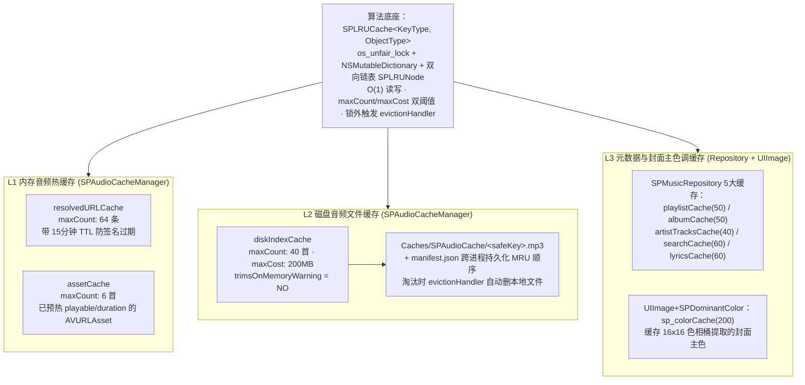

# 专题 ③：手写 $O(1)$ `SPLRUCache` 与 L1 / L2 / L3 三级缓存体系

> [← 返回架构总控台](README.md) · [← 上一专题：网络申请与多源并发聚合](02-网络申请与多源并发聚合.md) · **当前位置**：区块二（重点实现路径详解） > 专题 ③ 三级 LRU 缓存体系
> **关联架构层**：[第 4 层 Core 基础层 (`SPLRUCache`)](04-Core基础组件与Models领域模型层.md) · [第 3 层 Player (`SPAudioCacheManager`)](03-Player播放器内核架构层.md) · [第 2 层 Data (`SPMusicRepository`)](02-Data数据与网络架构层.md)

---

## 1. 全项目三级 LRU 缓存全景架构图

项目在设置页（[SPSettingsViewController.m:L512-L545](file:///Users/dyyxs/项目/Spotify/Spotify/Modules/Settings/SPSettingsViewController.m#L512-L545)）中直观展示了 L1、L2、L3 三级缓存的实时命中率与容量统计。这三级缓存全部构建在同一个手写泛型容器 [`SPLRUCache<KeyType, ObjectType>`](file:///Users/dyyxs/项目/Spotify/Spotify/Core/Cache/SPLRUCache.h) 之上：



---

## 2. 路径环节一：手写 $O(1)$ `SPLRUCache` 的四个核心工程细节

- **源码位置**：[SPLRUCache.h](file:///Users/dyyxs/项目/Spotify/Spotify/Core/Cache/SPLRUCache.h) / [SPLRUCache.m:L9-L229](file:///Users/dyyxs/项目/Spotify/Spotify/Core/Cache/SPLRUCache.m#L9-L229)

### 细节 1：为什么双向链表的 `prev` 用 `weak` 而 `next` 用 `strong`？
看 [SPLRUCache.m:L9-L15](file:///Users/dyyxs/项目/Spotify/Spotify/Core/Cache/SPLRUCache.m#L9-L15) 的节点定义：
```objc
@interface SPLRUNode : NSObject
@property (nonatomic, strong) id key;
@property (nonatomic, strong) id value;
@property (nonatomic, assign) NSUInteger cost;
@property (nonatomic, weak, nullable) SPLRUNode *prev;   // 弱引用前驱
@property (nonatomic, strong, nullable) SPLRUNode *next; // 强引用后继
@end
```
如果 `prev` 和 `next` 都是 `strong`，相邻两个节点会形成强引用环（Retain Cycle），在调用 `-removeAllObjects` 时即使把 `self.head = nil; self.tail = nil; [self.map removeAllObjects];`，节点之间也会因为循环引用而无法被 ARC 释放！将 `prev` 声明为 `weak` 后，整条链由 `head -> next -> next` 单向强引用串联（加上 `map` 字典强引用），清空时瞬间全部释放。

### 细节 2：为什么区分 `-objectForKey:` 与 `-peekObjectForKey:`？
- [`-objectForKey:`](file:///Users/dyyxs/项目/Spotify/Spotify/Core/Cache/SPLRUCache.m#L107-L121)：外部正式读取缓存，命中时执行 `[self moveToHead:node]`（提升为最近使用 MRU）并令 `self.hitCount += 1`。
- [`-peekObjectForKey:`](file:///Users/dyyxs/项目/Spotify/Spotify/Core/Cache/SPLRUCache.m#L123-L130)：仅查询是否存在，**不改变链表顺序、不计入 `hitCount`**。用在哪里？例如后台预加载 `preloadTracks:` 检查某首歌是否已经在缓存里时，或者 UI 检查 `hasCachedTrack:` 时——探测动作不应该污染真实的用户播放热度顺序和命中率统计！

### 细节 3：为什么 `evictionHandler` 必须在 `os_unfair_lock_unlock` 之后触发？
看 [`-setObject:forKey:cost:`](file:///Users/dyyxs/项目/Spotify/Spotify/Core/Cache/SPLRUCache.m#L136-L176) 的淘汰逻辑：
```objc
NSMutableArray<SPLRUNode *> *evicted = nil;
os_unfair_lock_lock(&_lock);
// ... 插入或更新节点，更新 self.totalCost ...
while (self.map.count > self.maxCount || (self.map.count > 0 && self.totalCost > self.maxCost)) {
    SPLRUNode *removed = [self popTail]; // 从链表尾部摘除最久未用节点
    if (!removed) break;
    if (self.evictionHandler) {
        if (!evicted) evicted = [NSMutableArray array];
        [evicted addObject:removed]; // 先在锁内暂存到局部数组
    }
}
os_unfair_lock_unlock(&_lock);

// 解锁后再执行回调！
for (SPLRUNode *node in evicted) {
    self.evictionHandler(node.key, node.value);
}
```
**原因**：`os_unfair_lock` 是**不可重入锁**。如果带着锁调用外部传入的 `evictionHandler` block，一旦外部在回调里又调用了 `cache.count` 或 `allKeysInMRUOrder`（例如 L2 磁盘缓存在 `evictionHandler` 里调用 `-persistManifestAsync` 读取 `[self.diskIndexCache allKeysInMRUOrder]`！），同一线程二次加锁会当场死锁卡死主线程！**“锁内摘链收集、锁外触发回调”** 是高并发缓存容器的标准范式。

### 细节 4：`trimsOnMemoryWarning` 开关的作用
- `SPLRUCache` 初始化时默认 `_trimsOnMemoryWarning = YES`，收到 `UIApplicationDidReceiveMemoryWarningNotification` 时自动调用 `[self trimToCount:self.count / 2]` 砍掉一半旧内存缓存。
- 但 L2 磁盘缓存的索引 `_diskIndexCache` 在初始化时显式设置了 `_diskIndexCache.trimsOnMemoryWarning = NO` ([SPAudioCacheManager.m:L64](file:///Users/dyyxs/项目/Spotify/Spotify/Player/Cache/SPAudioCacheManager.m#L64))——因为 `_diskIndexCache` 里存的只是几字节的文件大小数字，一旦响应内存警告被砍半，就会触发 `evictionHandler` 把用户辛辛苦苦下载到磁盘上的 `.mp3` 文件删掉一半！

---

## 3. 路径环节二：L1 内存音频热缓存（URL 15 分钟 TTL + Asset 预热）

- **源码位置**：[SPAudioCacheManager.m:L10-L122](file:///Users/dyyxs/项目/Spotify/Spotify/Player/Cache/SPAudioCacheManager.m#L10-L122)
- **两级内存容器**：
  1. `resolvedURLCache` (`SPLRUCache<NSString *, SPCachedRemoteURL *> *`，上限 64 条)：缓存通过 `/song/url/v1` 解析出来的远程音频流 URL 及其获取时刻 `cachedAt`。因为网易云 CDN 链接约 15~20 分钟过期，[`-validCachedURLForSafeKey:peekOnly:`](file:///Users/dyyxs/项目/Spotify/Spotify/Player/Cache/SPAudioCacheManager.m#L106-L115) 每次读取都会校验 `(CFAbsoluteTimeGetCurrent() - entry.cachedAt) < 15 * 60.0`，一旦过期立即同时淘汰 `resolvedURLCache` 和 `assetCache`。
  2. `assetCache` (`SPLRUCache<NSString *, AVURLAsset *> *`，上限 6 首)：缓存当前曲目及上下首预加载好的 `AVURLAsset` 对象。

---

## 4. 路径环节三：L2 磁盘音频文件缓存（200MB 上限 + `manifest.json` 跨进程恢复）

- **源码位置**：[SPAudioCacheManager.m:L63-L251](file:///Users/dyyxs/项目/Spotify/Spotify/Player/Cache/SPAudioCacheManager.m#L63-L251)
- **三个关键步骤**：
  1. **文件名安全编码** ([`-safeKeyForTrackId:`](file:///Users/dyyxs/项目/Spotify/Spotify/Player/Cache/SPAudioCacheManager.m#L201-L214))：将 `trackId` 中非字母数字字符转义为 `_xx` 十六进制，拼接扩展名（如 `.mp3` / `.m4a`）存入 `Library/Caches/SPAudioCache/`。
  2. **跨进程 MRU 顺序持久化与恢复** ([`-setupDiskCache` & `-persistManifestAsync`](file:///Users/dyyxs/项目/Spotify/Spotify/Player/Cache/SPAudioCacheManager.m#L126-L186))：
     - 每次磁盘文件被命中或新文件落盘时，调用 `[self.diskIndexCache allKeysInMRUOrder]` 导出从最新到最旧的 key 数组，在串行 `ioQueue` 上原子写入 `manifest.json`。
     - 下次 App 冷启动执行 `-setupDiskCache` 时：① 先清理上次异常退出遗留的 `.tmp` 临时文件；② 读取 `manifest.json`，用 `[mruKeys reverseObjectEnumerator]` **从最旧到最新逆序**调用 `[self.diskIndexCache setObject:@(size) forKey:safeKey cost:size]`（因为 `setObject:` 是头插法，逆序头插完后，最热的那首歌刚好回到 `head`！）；③ 补充扫描目录里存在但尚未记入 manifest 的音频文件。
  3. **自动容量淘汰** ([L70-L73](file:///Users/dyyxs/项目/Spotify/Spotify/Player/Cache/SPAudioCacheManager.m#L70-L73))：
     当落盘第 41 首歌或磁盘总字节数 `totalCost` 超过 `200MB` 时，`diskIndexCache` 自动弹出链表尾部的 `safeKey` 并触发 `evictionHandler` 调用 `-deleteDiskFileForSafeKey:`，在后台 `ioQueue` 删除对应 `.mp3` 文件并更新 `manifest.json`。

---

## 5. 路径环节四：L3 元数据预热与 `16x16` 色相桶封面取色缓存

### 5.1 `SPMusicRepository` 的首页预热与详情页首帧直出
- **源码位置**：[SPMusicRepository.m:L19-L48, L148-L160](file:///Users/dyyxs/项目/Spotify/Spotify/Data/Repository/SPMusicRepository.m#L148-L160) & [SPDetailViewController.m:L39-L74](file:///Users/dyyxs/项目/Spotify/Spotify/Modules/Detail/SPDetailViewController.m#L39-L74)
- **链路配合**：
  1. 首页请求返回 `sections` 时，`SPMusicRepository` 自动调用 `-warmCachesFromHomeSections:`，遍历所有分区的 item，将已经带有 `tracks` 的 `SPPlaylist` / `SPAlbum` 提前塞进 `playlistCache` / `albumCache`。
  2. 当用户点击卡片进入 `SPDetailViewController` 时，在 `-initWithMediaItem:` 构造阶段就同步调用 `[[SPMusicRepository shared] cachedPlaylistForId:item.identifier]`。如果命中，直接把 `_tracks = cached.tracks` 赋好——`viewDidLoad` 首帧直接渲染出完整歌单列表，连网络请求和 Skeleton 骨架屏都省去了！

### 5.2 `UIImage+SPDominantColor` 的 `16x16` 12 色相桶取色算法
- **源码位置**：[UIImage+SPDominantColor.m:L11-L156](file:///Users/dyyxs/项目/Spotify/Spotify/Core/Extensions/UIImage+SPDominantColor.m#L11-L156)
- **为什么不直接求整张图片的 RGB 平均值？**
  很多专辑封面有大面积的黑色背景或白色留白，如果直接求全图 RGB 均值，算出来的永远是毫无生气的深灰或浅灰；而如果遍历原图几十万像素，CPU 开销又太大。
- **算法四步曲**：
  1. **L3 缓存查表**：先用 `coverURL` 查容量 200 的静态 `SPLRUCache` (`+sp_colorCache`)，命中直接返回。
  2. **16×16 硬件重采样**：在后台队列创建 `16x16` 像素的 `CGBitmapContext`，将封面缩绘成 256 个像素点（耗时不到 0.1ms）。
  3. **过滤黑白灰 + 12 色相桶饱和度加权** ([L84-L135](file:///Users/dyyxs/项目/Spotify/Spotify/Core/Extensions/UIImage+SPDominantColor.m#L84-L135))：
     - 跳过透明像素 (`a < 64`)、极暗像素 (`maxC < 38`) 和高亮灰白像素 (`delta < 22 && maxC > 220`)；
     - 计算像素饱和度 `sat = delta / maxC`，赋予高饱和度像素更高权重 `weight = 1.0 + sat * 2.0`；
     - 计算色相 `hue` ($0.0 \sim 1.0$) 并投入 12 个色相桶 (`bucket = hue * 12`)，找出累计权重最大的主导色相桶并求桶内加权平均 RGB。
  4. **明度钳制**：最后调用 `[result sp_clampedForDarkBackground]` 将颜色的 HSB 明度限制在合理区间，确保作为详情页/播放页背景时，上面的白色标题和按钮始终具备高对比度。

---

> **下一专题导航**：[前往专题 ④：歌曲缓存漏斗、防竞态 Ticket 与上下首 0ms 预加载 →](04-歌曲缓存与上下首0ms预加载.md)
