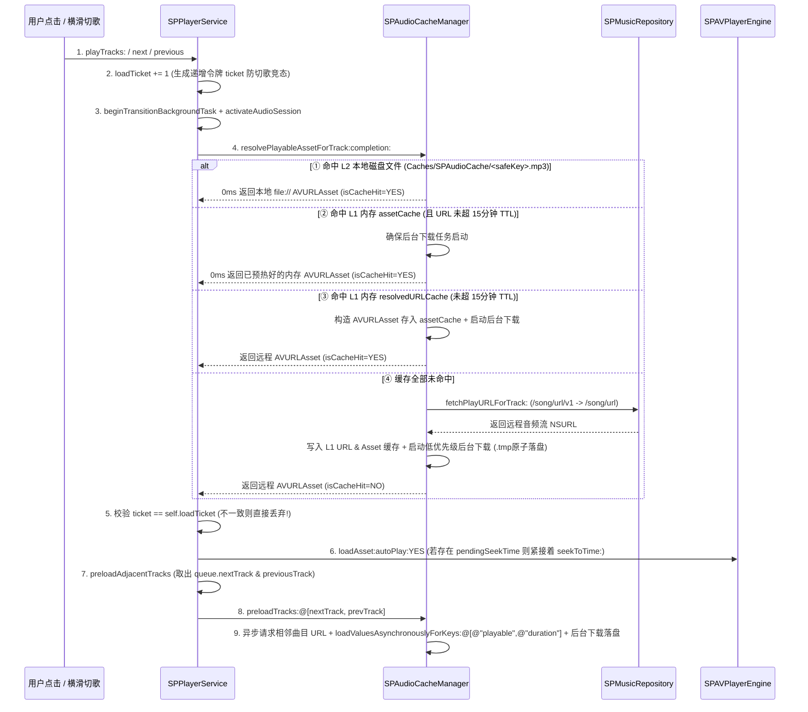

# 专题 ④：歌曲缓存漏斗、防竞态 Ticket 与上下首 0ms 预加载

> [← 返回架构总控台](README.md) · [← 上一专题：三级 LRU 缓存体系实现](03-三级LRU缓存体系实现.md) · **当前位置**：区块二（重点实现路径详解） > 专题 ④ 歌曲缓存与上下首 0ms 预加载
> **关联架构层**：[第 3 层 Player 播放内核层](03-Player播放器内核架构层.md)

---

## 1. 歌曲从点击播放到边播边存、再到预热下一首的全链路图



---

## 2. 路径环节一：`loadTicket` 递增令牌 —— 彻底解决快速切歌音画串台

- **源码位置**：[SPPlayerService.m:L25, L164-L168, L234-L284](file:///Users/dyyxs/项目/Spotify/Spotify/Player/SPPlayerService.m#L234-L284)
- **工程痛点**：
  假设用户在 1 秒内连续滑了 3 次切歌（歌 A → 歌 B → 歌 C）。由于歌 A 的网络请求可能因为服务端抖动比歌 C 晚返回，如果不加版本控制，歌 A 的 `resolvePlayableAssetForTrack:` 回调回来时就会调用 `[engine loadAsset:assetA]`，导致屏幕上显示的是歌 C 的封面和歌词，耳机里放出来的却是歌 A 的声音！
  同理，如果歌 C 还在异步请求 URL 的过程中用户按下了「暂停」按钮，等 URL 回来后也不应该突然自动出声播放。
- **代码实现**：
  ```objc
  // 1. 每次开始加载新曲目时，令 loadTicket 自增并捕获到栈变量 ticket
  - (void)startCurrentTrackWithAutoPlay:(BOOL)autoPlay {
      self.loadTicket += 1;
      NSUInteger ticket = self.loadTicket;
      SPTrack *track = self.currentTrack;
      ...
      __weak typeof(self) weakSelf = self;
      [[SPAudioCacheManager shared] resolvePlayableAssetForTrack:track
                                                      completion:^(AVURLAsset *asset, BOOL isCacheHit, NSError *error) {
          // 2. 异步回调第一行：比对令牌！若用户在此期间又切了歌或按了暂停，直接静默丢弃
          if (ticket != weakSelf.loadTicket) return;
          ...
          [weakSelf.engine loadAsset:asset autoPlay:YES];
          [weakSelf preloadAdjacentTracks];
      }];
  }

  // 3. 若在 URL 尚未解析回来前用户按了暂停，同样自增 loadTicket 作废正在飞行的请求
  - (void)pause {
      if (!self.currentTrack) return;
      if (!self.currentTrackLoadedInEngine) {
          self.loadTicket += 1;
          [self updateState:SPPlaybackStatePaused];
          return;
      }
      [self.engine pause];
  }
  ```

---

## 3. 路径环节二：`resolvePlayableAssetForTrack:` 四级命中漏斗

- **源码位置**：[SPAudioCacheManager.m:L270-L332](file:///Users/dyyxs/项目/Spotify/Spotify/Player/Cache/SPAudioCacheManager.m#L270-L332)
- **为什么 L2 本地磁盘优先级反而高于 L1 内存 Asset？**
  仔细看 [L283-L307](file:///Users/dyyxs/项目/Spotify/Spotify/Player/Cache/SPAudioCacheManager.m#L283-L307) 的顺序：
  1. **第一顺位是 L2 本地磁盘 (`diskFileURLIfExistsForSafeKey:`)**：因为 L1 `assetCache` 里存的可能是上一次刚预加载的**远程流媒体 `http://` URL Asset**（播放它仍需走网络流式缓冲），而如果此时后台下载任务已经把完整的 `.mp3` 文件落盘到了 L2 磁盘，直接使用本地 `file://` URL 构造的 `AVURLAsset` 可以做到 **100% 离线 0 缓冲、任意拖动进度条 0 等待**！同时把本地 `localAsset` 回写进 L1 `assetCache` 替换掉之前的远程 Asset。
  2. **第二顺位是 L1 内存 `assetCache`**：当后台下载还没下完，但预加载已经创建并预热了远程 `AVURLAsset` 时，校验其 URL 未超过 15 分钟 TTL 后直接返回该 `memAsset`，省去了重新请求 `/song/url/v1` 和重新握手解析音频头的时间。
  3. **第三顺位是 L1 内存 `resolvedURLCache`**：命中 15 分钟内有效 URL，立即包装成 `AVURLAsset` 返回并触发后台落盘。
  4. **第四顺位是 `SPMusicRepository fetchPlayURLForTrack:`**：走网络实时换取 URL，拿到后一方面立即交给 `AVPlayer` 流式起播，另一方面同步塞入 L1 并启动后台下载落盘。

---

## 4. 路径环节三：低优先级后台下载与 `.tmp` 原子重命名落盘

- **源码位置**：[SPAudioCacheManager.m:L367-L417](file:///Users/dyyxs/项目/Spotify/Spotify/Player/Cache/SPAudioCacheManager.m#L367-L417)
- **三大工程保障**：
  1. **串行队列 + `activeDownloads` 去重**：通过专用串行队列 `_ioQueue = dispatch_queue_create("com.dyyxs.spotify.audiocache.io", DISPATCH_QUEUE_SERIAL)` 检查 `if (self.activeDownloads[safeKey]) return;`，哪怕用户反复在两首歌之间横滑，同一首歌也绝不会发起第二次重复下载。
  2. **低优先级礼让前台流媒体**：设置 `task.priority = NSURLSessionTaskPriorityLow;` 且 `_downloadSession` 的 `HTTPMaximumConnectionsPerHost = 3`，确保后台预下载不会抢占当前正在播放歌曲的带宽。
  3. **先写 `.tmp` 再原子 `moveItemAtPath:`**：
     ```objc
     NSString *tmpPath = [finalPath stringByAppendingString:@".tmp"];
     NSFileManager *fm = [NSFileManager defaultManager];
     [fm removeItemAtPath:tmpPath error:nil];
     if ([fm copyItemAtURL:location toURL:[NSURL fileURLWithPath:tmpPath] error:nil]) {
         [fm removeItemAtPath:finalPath error:nil];
         if ([fm moveItemAtPath:tmpPath toPath:finalPath error:nil]) {
             unsigned long long fileSize = [[fm attributesOfItemAtPath:finalPath error:nil] fileSize];
             if (fileSize > 0) {
                 @synchronized (strongSelf.diskFileNames) {
                     strongSelf.diskFileNames[safeKey] = fileName;
                 }
                 [strongSelf.diskIndexCache setObject:@(fileSize) forKey:safeKey cost:(NSUInteger)fileSize];
                 [strongSelf persistManifestAsync];
             }
         }
     }
     ```
     这就保证了 `Caches/SPAudioCache/` 目录下只要是不带 `.tmp` 后缀的 `.mp3` 文件，就**一定是 100% 完整下载的音频文件**，绝不会出现半截损坏文件导致 `AVPlayer` 解码报错。

---

## 5. 路径环节四：上下首相邻曲目静默预加载 (`preloadAdjacentTracks`)

- **源码位置**：[SPPlayerService.m:L302-L312](file:///Users/dyyxs/项目/Spotify/Spotify/Player/SPPlayerService.m#L302-L312) & [SPAudioCacheManager.m:L334-L365](file:///Users/dyyxs/项目/Spotify/Spotify/Player/Cache/SPAudioCacheManager.m#L334-L365)
- **谁触发预加载？**
  1. 当前歌曲在 `-startCurrentTrackWithAutoPlay:` 中成功拿到 Asset 开始播放后 ([L282](file:///Users/dyyxs/项目/Spotify/Spotify/Player/SPPlayerService.m#L282))；
  2. 用户点击随机播放按钮 `-toggleShuffle` 导致队列顺序重洗后 ([L222](file:///Users/dyyxs/项目/Spotify/Spotify/Player/SPPlayerService.m#L222))；
  3. 用户点击某首歌的「下一首播放」调用 `-insertNextTrack:` 插队时 ([L146](file:///Users/dyyxs/项目/Spotify/Spotify/Player/SPPlayerService.m#L146))。
- **预加载究竟预热了什么？**
  看 [`-warmupAssetAndDiskForSafeKey:remoteURL:`](file:///Users/dyyxs/项目/Spotify/Spotify/Player/Cache/SPAudioCacheManager.m#L358-L365)：
  ```objc
  - (void)warmupAssetAndDiskForSafeKey:(NSString *)safeKey remoteURL:(NSURL *)remoteURL {
      if (![self.assetCache peekObjectForKey:safeKey]) {
          AVURLAsset *asset = [AVURLAsset URLAssetWithURL:remoteURL options:nil];
          [self.assetCache setObject:asset forKey:safeKey cost:1];
          // 核心：通知 AVFoundation 后台线程提前建立连接并解析音频流的 playable 与 duration 元数据！
          [asset loadValuesAsynchronouslyForKeys:@[@"playable", @"duration"] completionHandler:nil];
      }
      [self downloadToDiskInBackgroundForSafeKey:safeKey remoteURL:remoteURL];
  }
  ```
  `AVPlayer` 播放网络音频最慢的第一步就是解析音频容器头部的 `playable` 和 `duration` 属性。提前在听当前歌时对 `nextTrack` 和 `previousTrack` 调用 `loadValuesAsynchronouslyForKeys:@[@"playable", @"duration"]` 并启动后台落盘，当用户切到下一首时，要么文件已经落盘成 `.mp3` 直接 0ms 本地播，要么 `AVURLAsset` 的头部已经解析完毕直接秒进 `AVPlayerItemStatusReadyToPlay`！

---

> **下一专题导航**：[前往专题 ⑤：后台播放保活、锁屏控制中心与灵动岛集成 →](05-后台播放与锁屏灵动岛集成.md)
