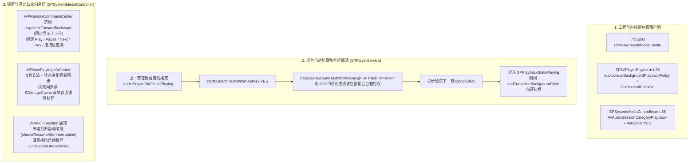

# 专题 ⑤：后台播放保活、锁屏控制中心与灵动岛集成

> [← 返回架构总控台](README.md) · [← 上一专题：歌曲缓存与上下首 0ms 预加载](04-歌曲缓存与上下首0ms预加载.md) · **当前位置**：区块二（重点实现路径详解） > 专题 ⑤ 后台播放与锁屏灵动岛
> **关联架构层**：[第 3 层 Player 播放内核层 (`SPSystemMediaController` / `SPPlayerService`)](03-Player播放器内核架构层.md)

---

## 1. 后台播放与系统媒体中心交互全景图



---

## 2. 路径环节一：三重后台播放权限配置

要让 iOS 允许 App 在锁屏或退到后台时继续发声，项目完成了三处配置：
1. **[Info.plist:L42-L45](file:///Users/dyyxs/项目/Spotify/Spotify/Resources/Info.plist#L42-L45)**：声明后台音频模式：
   ```xml
   <key>UIBackgroundModes</key>
   <array>
       <string>audio</string>
   </array>
   ```
2. **[SPAVPlayerEngine.m:L33-L35](file:///Users/dyyxs/项目/Spotify/Spotify/Player/Engine/SPAVPlayerEngine.m#L33-L35)**：配置 `AVPlayer` 的后台策略：
   ```objc
   _player.automaticallyWaitsToMinimizeStalling = YES;
   _player.allowsExternalPlayback = YES;
   _player.audiovisualBackgroundPlaybackPolicy = AVPlayerAudiovisualBackgroundPlaybackPolicyContinuesIfPossible;
   ```
3. **[SPSystemMediaController.m:L45-L50, L65-L70](file:///Users/dyyxs/项目/Spotify/Spotify/Player/System/SPSystemMediaController.m#L65-L70)**：激活 `AVAudioSessionCategoryPlayback`（忽略静音拨片，支持锁屏后台混音输出），并在 `UIApplicationDidEnterBackgroundNotification` 时二次确认激活状态。

---

## 3. 路径环节二：后台自动切歌的网络空窗期防挂起保活 (`SPTrackTransition`)

- **源码位置**：[SPPlayerService.m:L32, L258, L286-L300, L330-L332](file:///Users/dyyxs/项目/Spotify/Spotify/Player/SPPlayerService.m#L286-L300)
- **为什么很多 iOS 音乐播放器在锁屏后台播完一首歌后，没法自动播下一首？**
  - iOS 对 `UIBackgroundModes: audio` 的保活判定非常严格：**只有当 `AVPlayer` 正在积极输出音频流时，App 才能在后台保持运行**。
  - 当第 1 首歌自然播完触发 `AVPlayerItemDidPlayToEndTimeNotification` 时，当前 `AVPlayer` 已经停止发声；如果第 2 首歌需要发起异步网络请求 `/song/url/v1` 获取播放地址，在网络请求尚未返回的这 `200ms ~ 800ms` 空窗期里，`AVPlayer` 处于无声状态，iOS 系统往往会立刻将 App 进程冻结挂起（Suspend），导致网络回调永远无法执行！
- **本项目的解决方案（`UIBackgroundTaskIdentifier` 桥接过渡期）**：
  ```objc
  // 1. 在 startCurrentTrackWithAutoPlay:YES 发起异步解析前，立即向系统申请后台过渡任务
  - (void)beginTransitionBackgroundTask {
      [self endTransitionBackgroundTask];
      __weak typeof(self) weakSelf = self;
      self.transitionBackgroundTaskId = [[UIApplication sharedApplication]
          beginBackgroundTaskWithName:@"SPTrackTransition"
                    expirationHandler:^{
          [weakSelf endTransitionBackgroundTask];
      }];
  }

  // 2. 一旦新歌加载完成进入 Playing（或失败进入 Failed/Paused），立即结束后台任务
  - (void)updateState:(SPPlaybackState)state {
      if (self.state == state) return;
      self.state = state;
      if (state != SPPlaybackStateLoading) {
          [self endTransitionBackgroundTask];
      }
      [self notify:@selector(playerDidChangeState:)];
      [self syncNowPlayingInfoForce:YES];
  }
  ```
  通过 `beginBackgroundTaskWithName:@"SPTrackTransition"` 给“上一首结束 → 下一首起播”之间的网络请求空窗期架了一座保活桥梁，加上前面的 **相邻曲目预加载 (`preloadAdjacentTracks`)** 往往已经把下一首下载到了本地磁盘，双管齐下确保锁屏连续播放稳如磐石！

---

## 4. 路径环节三：`MPRemoteCommandCenter` 锁屏与灵动岛按钮定制

- **源码位置**：[SPSystemMediaController.m:L101-L183](file:///Users/dyyxs/项目/Spotify/Spotify/Player/System/SPSystemMediaController.m#L101-L183)
- **核心技巧 1：禁用快进/快退，强制灵动岛与锁屏显示「上一首 / 下一首」** ([L110-L115](file:///Users/dyyxs/项目/Spotify/Spotify/Player/System/SPSystemMediaController.m#L110-L115))：
  ```objc
  // 禁用快进/快退，确保锁屏和灵动岛稳定展示上一首/下一首按钮
  center.skipForwardCommand.enabled = NO;
  center.skipBackwardCommand.enabled = NO;
  center.seekForwardCommand.enabled = NO;
  center.seekBackwardCommand.enabled = NO;
  ```
- **核心技巧 2：支持锁屏与灵动岛直接拖拽进度条** ([L156-L166](file:///Users/dyyxs/项目/Spotify/Spotify/Player/System/SPSystemMediaController.m#L156-L166))：
  启用 `center.changePlaybackPositionCommand.enabled = YES`，在回调中将 `MPRemoteCommandEvent *` 强转为 `MPChangePlaybackPositionCommandEvent *`，读取 `event.positionTime` 调用 `[weakSelf.playerService seekToTime:position]`，并在 `seekToTime:` 完成后调用 `[weakSelf syncNowPlayingInfoForce:YES]` 立即把新的 `ElapsedPlaybackTime` 回写给系统锁屏，防止锁屏滑块松手后弹回旧位置。

---

## 5. 路径环节四：`MPNowPlayingInfoCenter` 5 秒节流与首帧封面同步读取

- **源码位置**：[SPPlayerService.m:L337-L345](file:///Users/dyyxs/项目/Spotify/Spotify/Player/SPPlayerService.m#L337-L345) & [SPSystemMediaController.m:L187-L270](file:///Users/dyyxs/项目/Spotify/Spotify/Player/System/SPSystemMediaController.m#L187-L270)
- **为什么不需要每 0.25s 更新一次 `nowPlayingInfo`？**
  iOS 的 `MPNowPlayingInfoCenter` 采用的是**“基准时间 + 播放速率推算”**模型：只要你告诉系统当前的 `MPNowPlayingInfoPropertyElapsedPlaybackTime`（当前已播秒数）、`MPMediaItemPropertyPlaybackDuration`（总时长）以及 `MPNowPlayingInfoPropertyPlaybackRate`（播放中传 `@(1.0)`，暂停或加载中传 `@(0.0)`），iOS SpringBoard 进程自己就会按 `1.0x` 速率在锁屏和灵动岛上平滑推进进度条！
  因此 [`-syncNowPlayingInfoForce:`](file:///Users/dyyxs/项目/Spotify/Spotify/Player/SPPlayerService.m#L337-L345) 做了 5 秒节流：
  ```objc
  - (void)syncNowPlayingInfoForce:(BOOL)force {
      NSTimeInterval now = CFAbsoluteTimeGetCurrent();
      BOOL durationJustResolved = (self.lastSyncedDuration <= 0 && self.duration > 0);
      if (force || durationJustResolved || (now - self.lastInfoUpdateTimestamp >= 5.0)) {
          self.lastSyncedDuration = self.duration;
          self.lastInfoUpdateTimestamp = now;
          [self.systemController updateNowPlayingInfo];
      }
  }
  ```
- **灵动岛首帧封面零延迟技巧** ([SPSystemMediaController.m:L249-L256](file:///Users/dyyxs/项目/Spotify/Spotify/Player/System/SPSystemMediaController.m#L249-L256))：
  切歌瞬间，如果直接走异步网络回调加载封面，锁屏和灵动岛会先闪一下灰色默认音符图标。为此 `-loadArtworkForTrack:` 优先调用 `SDImageCache` 的同步接口：
  ```objc
  NSString *cacheKey = [[SDWebImageManager sharedManager] cacheKeyForURL:url];
  UIImage *cachedImg = [[SDImageCache sharedImageCache] imageFromCacheForKey:cacheKey];
  if (cachedImg) {
      self.cachedArtwork = [[MPMediaItemArtwork alloc] initWithBoundsSize:cachedImg.size
                                                           requestHandler:^UIImage *(CGSize size) { return cachedImg; }];
      return;
  }
  ```
  因为用户在列表或播放页看到的歌曲封面通常已经被 `SDWebImage` 缓存过了，这里同步命中后，第一帧写入 `nowPlayingInfo` 时就已经自带高清专辑封面！

---

## 6. 路径环节五：来电打断自动续播与拔耳机自动暂停

- **源码位置**：[SPSystemMediaController.m:L72-L97](file:///Users/dyyxs/项目/Spotify/Spotify/Player/System/SPSystemMediaController.m#L72-L97)
- **来电/Siri/闹钟打断 (`AVAudioSessionInterruptionNotification`)**：
  - 用布尔属性 `self.shouldResumeAfterInterruption` 记录**打断开始那一刻是否正在播放** (`self.playerService.isPlaying`)；
  - 如果打断前本来就是暂停状态，那么挂断电话后绝不能自作主张开始放歌；只有当打断前正在播放，且系统在 `AVAudioSessionInterruptionTypeEnded` 中给出了 `AVAudioSessionInterruptionOptionShouldResume` 标志时，才重新激活会话并自动调用 `[self.playerService play]`。
- **耳机拔出/蓝牙断开 (`AVAudioSessionRouteChangeNotification`)**：
  - 当 `reason == AVAudioSessionRouteChangeReasonOldDeviceUnavailable` 时，立即切主线程调用 `[self.playerService pause]`，符合 iOS 人机交互指南（HIG）要求。

---

> **下一专题导航**：[前往专题 ⑥：首页无限刷新（上滑渐进分页）、并发保序与无闪烁插入 →](06-首页无限刷新与渐进分页.md)
