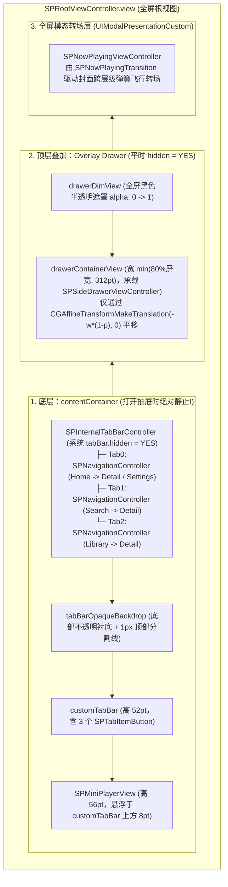
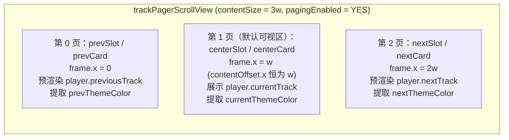

# 专题 ⑦：界面架构、三明治根容器、三槽位横滑切歌与封面飞行转场

> [← 返回架构总控台](README.md) · [← 上一专题：首页无限刷新与渐进分页](06-首页无限刷新与渐进分页.md) · **当前位置**：区块二（重点实现路径详解） > 专题 ⑦ 界面架构与丝滑转场交互
> **关联架构层**：[第 1 层 App 容器层 (`SPRootViewController` / `SPNavigationController`)](01-App与容器架构层.md) · [第 5 层 Modules (`SPMiniPlayerView` / `SPNowPlayingViewController` / `SPNowPlayingTransition`)](05-Modules业务界面模块层.md)

---

## 1. 全局界面视图层级（Z 轴三明治结构）

Spotify 的界面架构与普通“一个 `UITabBarController` 包三个 `UINavigationController`”的传统 iOS App 有本质区别。看 [SPRootViewController.m:L181-L385](file:///Users/dyyxs/项目/Spotify/Spotify/App/SPRootViewController.m#L181-L385) 的视图树层级（从底到顶）：



---

## 2. 路径环节一：隐藏原生 TabBar + 动态 `additionalSafeAreaInsets.bottom`

- **源码位置**：[SPRootViewController.m:L25-L51, L217-L318](file:///Users/dyyxs/项目/Spotify/Spotify/App/SPRootViewController.m#L217-L318)
- **为什么要隐藏系统 `UITabBar`，自己写 `customTabBar` + `SPMiniPlayerView`？**
  1. 在 Spotify 中，当你在「首页」点击一个歌单 Push 进入二级页 `SPDetailViewController` 时，**底部的 TabBar 和悬浮的 `SPMiniPlayerView` 都必须保持在原位不动**（不能像系统 `hidesBottomBarWhenPushed` 那样被推走，也不能在 Push 动画时出现层级遮挡）。
  2. 将 `SPInternalTabBarController` 的系统 `tabBar` 彻底隐藏 (`self.tabBar.hidden = YES`)，把 `customTabBar` (52pt) 和 `miniPlayer` (56pt) 直接挂在父容器 `contentContainer` 上。这样无论当前 Tab 内部的 `SPNavigationController` Push 了多少层页面，都发生在 `tabController.view` 内部，底部的 `miniPlayer` 和 `customTabBar` 永远稳居顶层！
  3. **再次点击当前已选中的底部 Tab 按钮自动回到根页** ([L285-L296](file:///Users/dyyxs/项目/Spotify/Spotify/App/SPRootViewController.m#L285-L296))：当用户在详情页或设置页时，再次点击底栏当前高亮的 Tab 图标，会自动执行 `[nav popToRootViewControllerAnimated:YES]` 瞬间回到该 Tab 首屏。
- **动态安全区注入：子页面列表怎么知道底部要留多少空白？** ([L305-L313](file:///Users/dyyxs/项目/Spotify/Spotify/App/SPRootViewController.m#L305-L313))
  如果每个页面的 `UITableView` / `UICollectionView` 都手动硬编码 `contentInset.bottom = 124`，一旦 `miniPlayer` 隐藏或显示，所有页面都要写监听代码去改 `contentInset`。
  本项目利用了 UIKit 原生的 `additionalSafeAreaInsets` 传导机制：
  ```objc
  - (void)updateTabDockMetrics {
      BOOL visible = ([SPPlayerService shared].currentTrack != nil);
      // 计算底部 Dock 总高度：52pt (TabBar) + 72pt (MiniPlayer 56pt + 上下边距 16pt) = 124pt
      CGFloat inset = SPDockTabBarHeight + (visible ? (SPMiniPlayerHeight + 16.0) : 6.0);
      for (UIViewController *vc in self.tabController.viewControllers) {
          UIEdgeInsets insets = vc.additionalSafeAreaInsets;
          insets.bottom = inset;
          vc.additionalSafeAreaInsets = insets;
      }
  }
  ```
  UIKit 会自动把父容器注入的 `additionalSafeAreaInsets.bottom` 叠加到每个子页面 ScrollView 的 `adjustedContentInset.bottom` 上，全项目所有列表的最后一行自动完美避让 MiniPlayer！

---

## 3. 路径环节二：零抖动抽屉、手势仲裁与「先静默 Push 再拉幕」转场

- **源码位置**：[SPRootViewController.m:L441-L591](file:///Users/dyyxs/项目/Spotify/Spotify/App/SPRootViewController.m#L441-L591) & [SPNavigationController.m:L13-L26](file:///Users/dyyxs/项目/Spotify/Spotify/App/SPNavigationController.m#L13-L26)

### 3.1 为什么拉出左侧抽屉时丝毫不掉帧（Zero Jitter）？
看 [`-applyDrawerProgress:`](file:///Users/dyyxs/项目/Spotify/Spotify/App/SPRootViewController.m#L496-L502)：
```objc
- (void)applyDrawerProgress:(CGFloat)progress {
    CGFloat clamped = MIN(MAX(progress, 0.0), 1.0);
    CGFloat w = [self calculatedDrawerWidth];
    // 主视图 contentContainer 绝对静止；仅叠加层与左侧抽屉平移滑入
    self.drawerContainerView.transform = CGAffineTransformMakeTranslation(-w * (1.0 - clamped), 0);
    self.drawerDimView.alpha = clamped;
}
```
不修改任何 Masonry 约束、不改变底层 `contentContainer` 的坐标，仅通过 GPU 硬件加速的 `CGAffineTransformMakeTranslation` 平移抽屉图层。

### 3.2 左边缘手势冲突仲裁：抽屉呼出 vs 二级页右滑返回
- `SPRootViewController.view` 上挂了左边缘手势 `UIScreenEdgePanGestureRecognizer *edgePan` 用于呼出抽屉；
- `SPNavigationController` 隐藏系统导航栏后，接管了 `interactivePopGestureRecognizer.delegate` 用于二级页左边缘右滑返回。
- **两者都在屏幕左边缘，怎么保证在一级页右滑是开抽屉、在二级页右滑是返回上一页？**
  看 [SPRootViewController.m:L452-L460](file:///Users/dyyxs/项目/Spotify/Spotify/App/SPRootViewController.m#L452-L460)：
  ```objc
  - (BOOL)gestureRecognizerShouldBegin:(UIGestureRecognizer *)gestureRecognizer {
      if (gestureRecognizer == self.edgePan) {
          if (self.drawerOpen) return NO;
          UINavigationController *nav = (UINavigationController *)self.tabController.selectedViewController;
          if ([nav isKindOfClass:UINavigationController.class] && nav.viewControllers.count > 1) {
              return NO; // 当前处于二级页（如歌单详情页/设置页）时，抽屉手势主动放弃，让位给侧滑返回！
          }
          return YES;
      }
      ...
  ```

### 3.3 从抽屉点击进入「设置 / 历史 / 动态」的单段无痕转场
看 [`-handleDrawerAction:`](file:///Users/dyyxs/项目/Spotify/Spotify/App/SPRootViewController.m#L562-L591)：
如果按常规写法“先关掉抽屉动画 (0.22s) → 完成后再调 `[nav pushViewController:targetVC animated:YES]` (0.35s)”，用户会看到：**抽屉向左滑走露出底下的首页 → 首页闪了一下 → 设置页又从右边飞进来**，两次反向的水平运动非常割裂。
本项目的编排巧思：
```objc
if (targetVC) {
    UINavigationController *nav = (UINavigationController *)self.tabController.selectedViewController;
    if ([nav isKindOfClass:UINavigationController.class] && ![nav.topViewController isKindOfClass:targetVC.class]) {
        // 1. 趁抽屉还盖在上面，先在静止的底层导航栈无动画瞬时就位目标页！
        [nav pushViewController:targetVC animated:NO];
    }
}
// 2. 紧接着把抽屉和黑色遮罩平滑向左滑出，就像拉开舞台帷幕一样直接显露设置页！
[self closeSideDrawerAnimated:YES completion:nil];
```

---

## 4. 路径环节三：三槽位 (`Prev` / `Center` / `Next`) 无限横滑切歌与实时色彩插值

- **源码位置**：[SPMiniPlayerView.m:L122-L158, L311-L437](file:///Users/dyyxs/项目/Spotify/Spotify/Modules/MiniPlayer/SPMiniPlayerView.m#L368-L437) & [SPNowPlayingViewController.m:L251-L287, L667-L830](file:///Users/dyyxs/项目/Spotify/Spotify/Modules/NowPlaying/SPNowPlayingViewController.m#L756-L830)

`SPMiniPlayerView`（迷你播放条）与 `SPNowPlayingViewController`（全屏大播放页）采用了完全一致的 **「三槽位无限复用分页器」** 架构：



### 为什么这套三槽位机制如此丝滑？
1. **相邻封面提前就位**：每当切歌、队列改变或切换随机模式时，`center` 槽位加载当前歌曲，同时 `prev` 槽位和 `next` 槽位立即提前用 SDWebImage 加载好上一首和下一首的封面与歌名，并提前算好各自的封面主色调 (`prevThemeColor` / `nextThemeColor`)。所以当你的手指刚开始往左拉 1 个像素时，下一首歌的封面和标题**早已经在右侧槽位画好等着你了**！
2. **滑动过程中的背景色实时线性插值** ([SPNowPlayingViewController.m:L756-L771](file:///Users/dyyxs/项目/Spotify/Spotify/Modules/NowPlaying/SPNowPlayingViewController.m#L756-L771))：
   ```objc
   CGFloat delta = (scrollView.contentOffset.x - self.lastPagerWidth) / self.lastPagerWidth; // 范围 -1.0 ~ +1.0
   UIColor *base = self.currentThemeColor ?: [UIColor sp_colorWithHex:0x28282D];
   UIColor *morphed = base;
   if (delta > 0 && self.nextThemeColor) {
       morphed = [base sp_interpolatedToColor:self.nextThemeColor fraction:delta];
   } else if (delta < 0 && self.prevThemeColor) {
       morphed = [base sp_interpolatedToColor:self.prevThemeColor fraction:-delta];
   }
   self.backgroundGradient.colors = @[morphed, [morphed sp_darkenedBy:0.55], darkCanvas];
   ```
   手指拖动进度 `delta` 从 `0.0` 到 `1.0` 的过程中，背景渐变色按帧在当前封面色与下一首封面色之间平滑呼吸过渡。
3. **松手落定瞬间的「视觉接力 + 瞬移回中」零闪烁技巧** ([SPNowPlayingViewController.m:L806-L830](file:///Users/dyyxs/项目/Spotify/Spotify/Modules/NowPlaying/SPNowPlayingViewController.m#L806-L830))：
   当用户滑到第 2 页（`nextCard`）松手减速停止时，我们需要让 `scrollView` 重新回到第 1 页（`centerCard`，`contentOffset.x = w`）以便下次还能继续往右滑。如果直接调 `setContentOffset:CGPointMake(w, 0)` 再调 `[player next]`，画面会先闪回旧歌再变成新歌！
   看代码是如何做到 **0 闪烁接力** 的：
   ```objc
   // ① 先把当前用户眼前的 sourceCard (nextCard) 上的 image、文字、颜色原封不动拷贝给中间的 centerCard
   SPNowPlayingTrackCardView *sourceCard = isNext ? self.nextCard : self.prevCard;
   UIColor *targetColor = isNext ? self.nextThemeColor : self.prevThemeColor;

   self.renderedTrackId = targetTrack.identifier;
   self.centerCard.trackIdentifier = targetTrack.identifier;
   self.centerCard.coverView.image = sourceCard.coverView.image;
   self.centerCard.trackTitleLabel.text = sourceCard.trackTitleLabel.text;
   self.centerCard.artistLabel.text = sourceCard.artistLabel.text;
   if (targetColor) {
       self.currentThemeColor = targetColor;
       [self applyGradientWithTopColor:targetColor animated:NO];
   }

   // ② 此时 centerCard 和 nextCard 长得一模一样！关闭滚动监听，无动画瞬间把镜头切回中间的 centerCard
   self.ignorePagerScrollEvents = YES;
   [scrollView setContentOffset:CGPointMake(self.lastPagerWidth, 0) animated:NO];
   self.ignorePagerScrollEvents = NO;

   // ③ 最后触发播放器真正切歌（因为 renderedTrackId 已更新，reloadTrackAnimated: 会跳过重绘 centerCard，只静默更新左右两侧新的 prevCard 和 nextCard！）
   if (isNext) [player next]; else [player skipToPreviousTrack];
   ```

---

## 5. 路径环节四：`SPNowPlayingTransition` 封面跨层级弹簧飞行转场

- **源码位置**：[SPNowPlayingTransition.m:L9-L163](file:///Users/dyyxs/项目/Spotify/Spotify/Modules/Transition/SPNowPlayingTransition.m#L9-L163)
- **实现原理**：
  1. `SPRootViewController` 在初始化 `SPNowPlayingTransition` 时传入一个 block `sourceCoverProvider: ^UIView *{ return weakSelf.miniPlayer.coverView; }`，动态提供底部 MiniPlayer 当前居中槽位的小封面视图。
  2. Present 展开全屏播放页时（`self.presenting == YES`）：
     - 先将 `toVC.view` 加入 `transitionContext.containerView` 并调用 `[toVC.view layoutIfNeeded]` 强制完成 AutoLayout 计算；
     - 调用 `[sourceCover convertRect:sourceCover.bounds toView:container]` 获取底部 `40x40` 小封面在全局容器中的起始坐标 `sourceFrame`；
     - 调用 `[targetCover convertRect:targetCover.bounds toView:container]` 获取全屏页中央大封面在全局容器中的目标坐标 `targetFrame`；
     - 令 `sourceCover.hidden = YES; targetCover.hidden = YES;`，在 `container` 顶层创建一张临时的 `floatingCover`，在 `0.42s` 的 Spring 动画（`damping: 0.88`）中将 `floatingCover.frame` 从 `sourceFrame` 变为 `targetFrame`、`cornerRadius` 从 `4pt` 变为 `8pt`，同时将 `toVC.view` 从向下偏移 `40pt` 半透明渐显归位；
     - 动画结束瞬间移除 `floatingCover` 并恢复真封面 `hidden = NO`。
  3. Dismiss 关闭全屏播放页时（包括点击左上角下拉箭头或手指下拉手势关闭）：执行完全对称的逆向动画，大封面精准飞回底部 MiniPlayer 的小封面槽位！

---

> [← 返回架构总控台 (README.md)](README.md)
